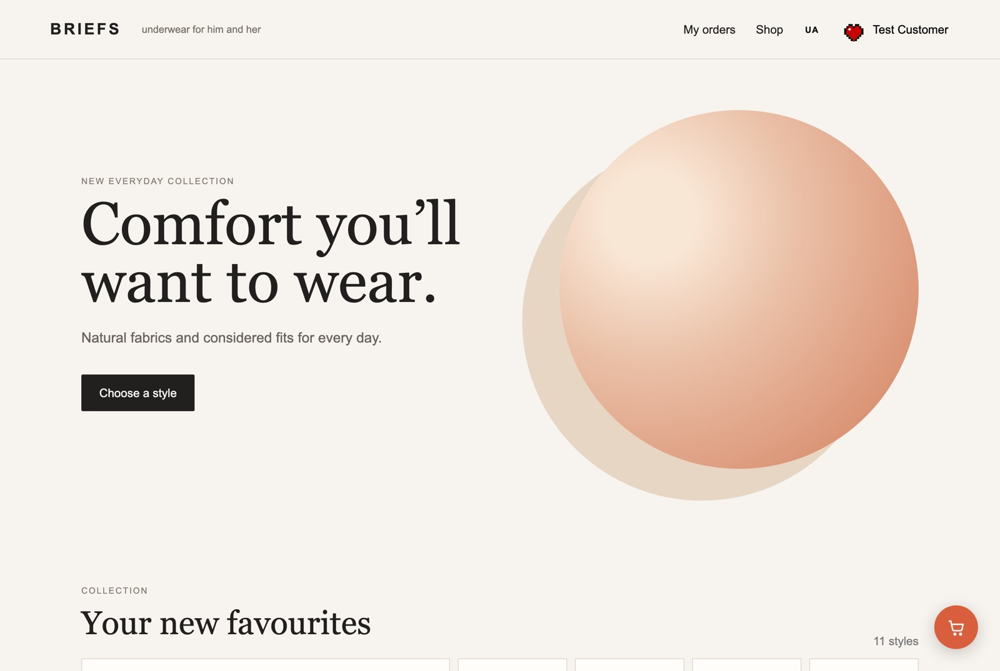
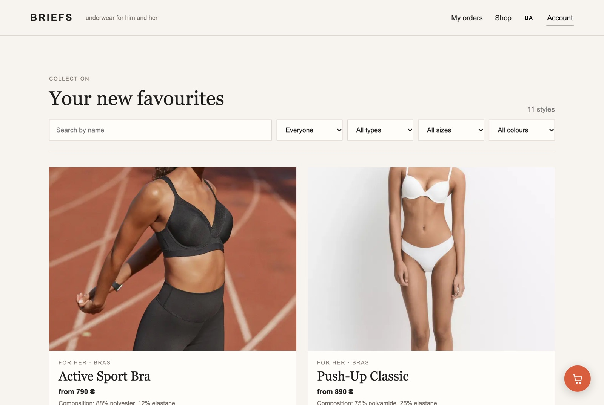
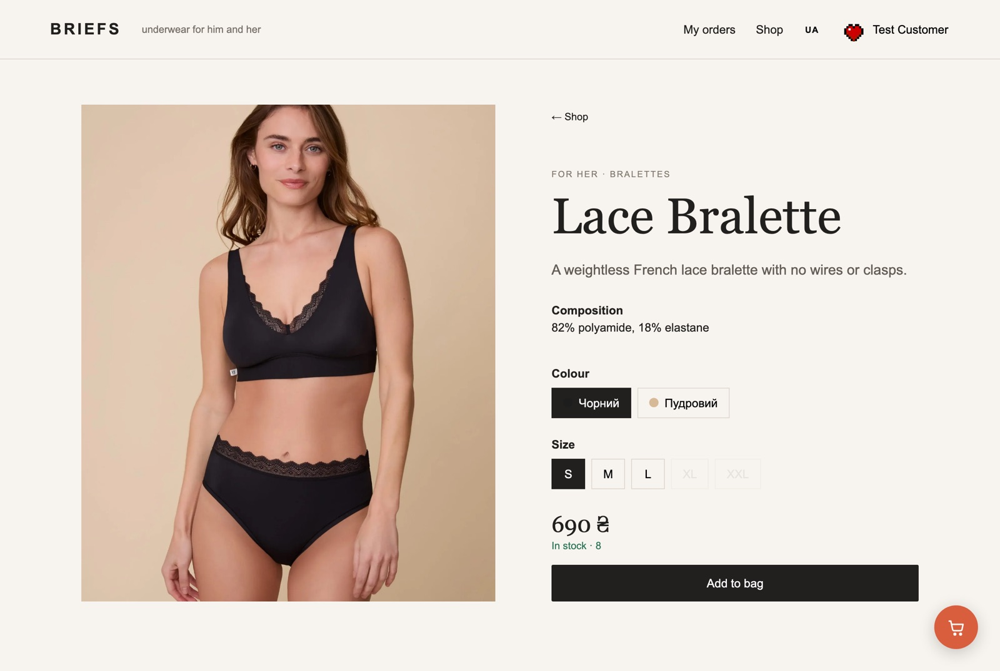
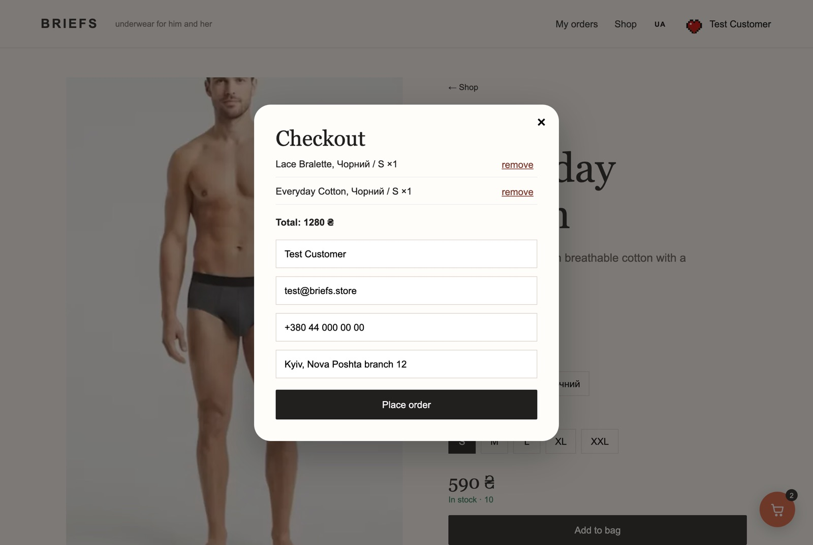
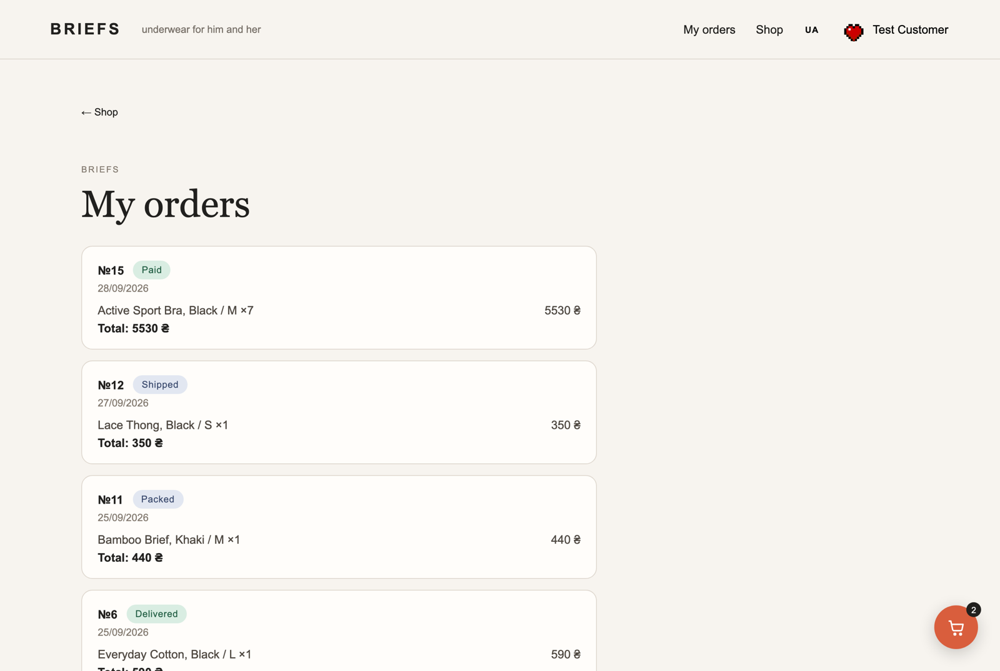
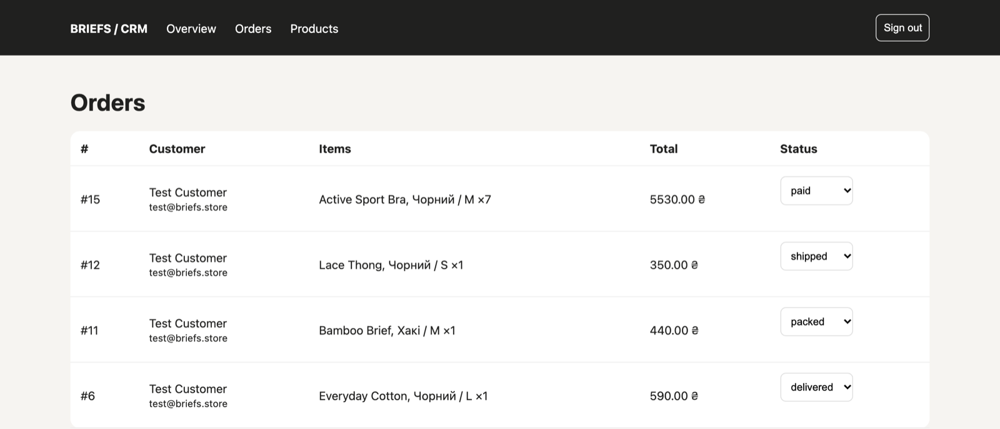
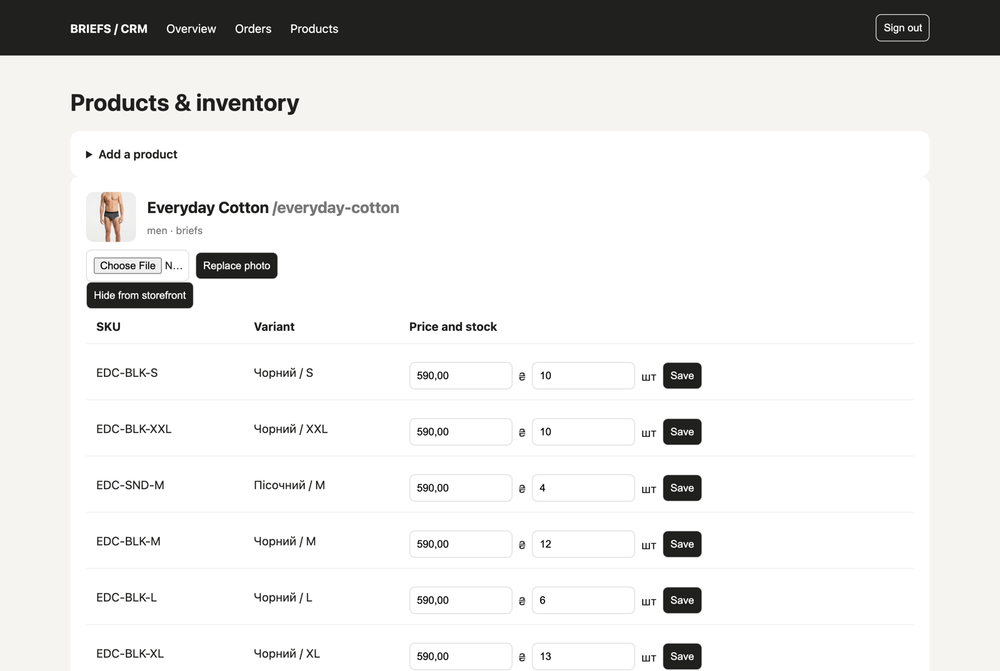
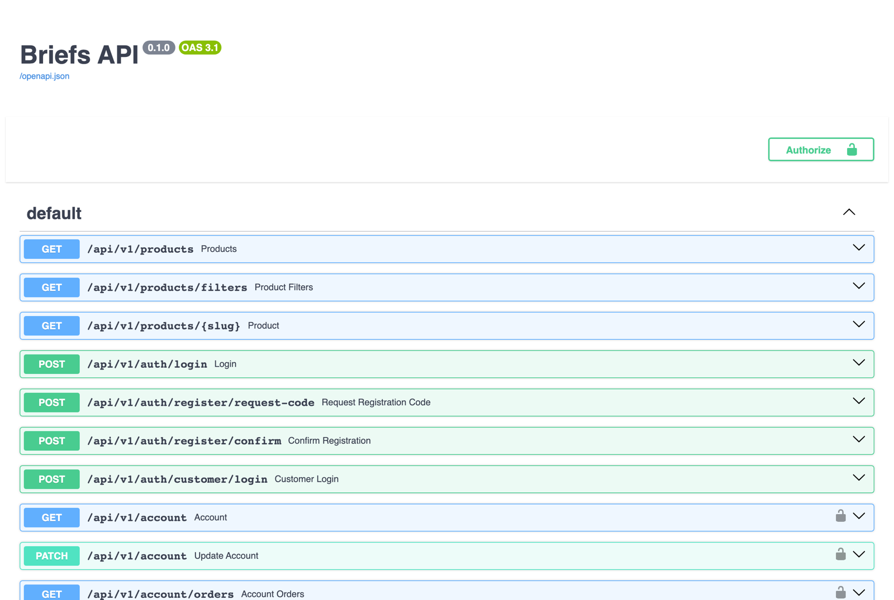

# BRIEFS — underwear store with its own CRM

[](https://github.com/Sebastian-null/pet-project/actions/workflows/ci.yml)

A full e-commerce slice built from scratch: a bilingual storefront, a REST API, a back-office CRM for the
shop's staff, Stripe Checkout payments, and 104 tests that run against a real PostgreSQL in CI.
Everything starts with one `docker compose up`.



---

## What's inside

**Storefront** (Next.js, server-rendered)
- Catalogue of `Product → Variant → SKU` with colour, size, price and stock per variant
- Filters by section, product type, size and colour, plus search that waits for typing to settle
  (the API also takes a price range)
- Ukrainian and English versions (`/uk`, `/en`); an unknown locale returns a real 404
- Colours and categories live in the database as codes and get their display name from the locale
  dictionary, so neither language leaks into the other
- Bag kept in `localStorage`, survives a reload and is cleared after a successful payment

**Customer accounts**
- Sign-up with a six-digit code sent by email, sign-in, password change
- Profile with name, phone, date of birth and an avatar upload
- Order history with live statuses; an order placed while signed in is linked to the account

**CRM** (server-rendered Jinja2 + HTMX, no separate frontend)
- Two roles: a *manager* works orders, an *admin* additionally owns the catalogue, prices and stock
- Create products, add variants, edit price and stock inline, upload a photo, hide a product from the storefront
- Order board with status changes; cancelling an order returns its units to stock

**Payments** — Stripe Checkout in UAH, confirmed by webhook only, never by the redirect

**Operations** — a background sweep cancels abandoned orders and frees their stock, rate limiting on
every authentication endpoint, a `/health` endpoint, and Alembic migrations that run on container start

---

## Screenshots

| Catalogue with filters | Filtered down to women's bras |
| --- | --- |
|  |  |

| Product page | Bag and checkout |
| --- | --- |
|  |  |

**Customer order history**



**CRM — order board**



**CRM — catalogue and stock**



**Generated OpenAPI documentation**



---

## Architecture

The storefront never touches the database. It talks to the API over HTTP, and so does everything else —
the CRM is simply a second set of routes on the same FastAPI app, rendered on the server.

```
                      ┌──────────────────────────┐
   browser  ────────▶ │  Next.js storefront      │  SSR catalogue, client-side bag
                      │  :3000                   │
                      └────────────┬─────────────┘
                                   │  REST / JSON
                                   ▼
   staff    ────────▶ ┌──────────────────────────┐        ┌──────────────┐
   browser            │  FastAPI  :8000          │ ─────▶ │ PostgreSQL   │
                      │  /api/v1   REST API      │  SQL   │ :5432        │
                      │  /admin    CRM (HTMX)    │ ◀───── │              │
                      │  /media    uploads       │        └──────────────┘
                      └──────┬───────────▲───────┘
                             │           │  checkout.session.* webhook
                             ▼           │
                      ┌─────────────┐  ┌─┴──────────┐
                      │  Mailpit    │  │  Stripe    │
                      │  (dev mail) │  │  Checkout  │
                      └─────────────┘  └────────────┘
```

**How an order is placed.** The API reserves stock inside one transaction (`SELECT … FOR UPDATE`, so two
shoppers cannot buy the same last unit), creates the order as `new`, and returns a Stripe Checkout URL.
The order only becomes `paid` when the `checkout.session.completed` webhook arrives — the browser
redirect is never trusted. If the shopper walks away, Stripe expires the session, the webhook (or the
background sweep, as a safety net) cancels the order and the reserved units go back on the shelf.

---

## Tech stack

| Layer | Choice | Why |
| --- | --- | --- |
| Storefront | Next.js 15 (App Router), React 19, TypeScript | server-rendered catalogue for SEO, typed API responses |
| API | FastAPI, Pydantic v2 | typed request/response models and OpenAPI docs for free |
| Database | PostgreSQL 16, SQLAlchemy 2, Alembic | row-level locking for stock, versioned schema |
| CRM | Jinja2 + HTMX | a back-office for a handful of staff does not need a second SPA |
| Auth | JWT (PyJWT) + bcrypt | bearer tokens for the API, an httpOnly cookie for the CRM |
| Payments | Stripe Checkout | hosted payment page, minimal PCI scope |
| Infra | Docker Compose, GitHub Actions | one command to run, every push tested |

---

## Running it locally

```bash
cp .env.example .env
docker compose up --build
```

| | |
| --- | --- |
| Storefront | http://localhost:3000 |
| API + Swagger UI | http://localhost:8000/docs |
| CRM | http://localhost:8000/admin/login |
| Mailpit (catches every outgoing email) | http://localhost:8025 |

Migrations and seed data run automatically on start: 11 products with variants, and three demo accounts.

| Account | Login | Password |
| --- | --- | --- |
| CRM admin | `admin@briefs.store` | `change-me-now` |
| CRM manager | `manager@briefs.store` | `change-me-now` |
| Shopper | `test@briefs.store` | `BriefsTest2026!` |

> The seeded passwords are deliberately obvious. They are for a local demo and must be changed before
> anything is deployed.

In `development` the API also returns the email verification code in its own response, so you can register
a shopper without reading the mailbox. Set `ENVIRONMENT=production` for a real deployment — it turns that
off and marks the CRM cookie `Secure`.

---

## Payments

1. Put `STRIPE_SECRET_KEY`, `STRIPE_WEBHOOK_SECRET` and `STOREFRONT_URL` in `.env`
   (plus `STRIPE_CURRENCY` if it is not `uah`).
2. Forward events to the local API:

```bash
stripe listen \
  --events checkout.session.completed,checkout.session.expired,checkout.session.async_payment_succeeded,checkout.session.async_payment_failed \
  --forward-to localhost:8000/api/v1/payments/stripe/webhook
```

   The CLI prints a `whsec_…` secret — that is `STRIPE_WEBHOOK_SECRET`. After adding it, recreate the
   container: `docker compose up -d backend`.
3. Pay with test card `4242 4242 4242 4242`, any future expiry and CVC.

Without Stripe keys the shop still works: the order is created and `payment_url` comes back `null`.

---

## Tests and CI

The suite runs against a real PostgreSQL, not SQLite — the app depends on row locking and
timezone-aware timestamps, which SQLite quietly ignores. The test database is created on first run.
With the stack already up:

```bash
docker compose exec backend sh -c "pip install -r requirements-dev.txt && pytest && ruff check ."
```

Outside Docker, point `TEST_DATABASE_URL` at any PostgreSQL you have and run `pytest` from `backend/`.

Every push runs both jobs in [GitHub Actions](.github/workflows/ci.yml): the backend against a PostgreSQL
service container, and the storefront through `tsc --noEmit`, ESLint and a production `next build`.

The suite is not only happy paths. `test_account_takeover.py`, `test_hardening.py`, `test_security.py`
and `test_validation.py` are regression tests written after security reviews — each one reproduces a bug
that existed, so it cannot come back.

---

## Security work

This started as a shop and turned into the part of the project I learned the most from. Three review
passes, each one reproducing the attack first and then closing it:

- **Account takeover through guest checkout.** Checkout looked customers up by the email typed into the
  form, so a guest could overwrite a registered shopper's name and phone and push orders into their
  account. A guest using an email that already has a password now gets a 401.
- **Customer tokens passing as staff.** Both token types carried a numeric id, so a customer whose id
  matched a staff id authenticated into the CRM. Tokens now carry a `kind` claim that is checked.
- **Stock that never came back.** Cancelling an order in the CRM left its units reserved forever; stock
  handling moved into `inventory.py` and a cancelled order can no longer be re-opened.
- **Uploads.** Images are identified by their actual file signature rather than the `Content-Type` the
  client claims, and read in 64 KB chunks with a hard cap, so a chunked upload cannot exhaust memory.
- **Smaller fixes.** Hidden products could still be bought by variant id; a one-character password
  passed registration; the rate limiter grew without bound; malformed tokens and `null` profile fields
  returned 500s instead of 4xx. Dependencies with known CVEs were upgraded (notably Next.js, which had a
  critical RCE in the image optimiser the catalogue relies on).

Also in place: `nosniff`, `X-Frame-Options`, `Referrer-Policy` on every response, an 8 MB body cap,
SRI on the one external script the CRM loads, and a refusal to boot in production with the default
`JWT_SECRET`.

---

## Known trade-offs

Deliberate decisions for a portfolio project rather than oversights:

- The customer token lives in `localStorage` for 14 days and cannot be revoked. An httpOnly cookie
  would be better and means reworking storefront auth.
- The CRM has no CSRF tokens; it relies on `SameSite=Lax` on the session cookie.
- Rate-limit counters are in process memory, which is enough for one API container — a multi-instance
  deployment would move them to Redis.
- `postcss` ships a high-severity advisory transitively through Next.js. It affects build-time CSS with
  attacker-controlled sources, which is not how this project builds.
- Emails are sent synchronously; a real shop would hand them to a queue.

---

## Project layout

```
backend/
  app/
    api.py          REST API: catalogue, auth, account, checkout
    admin.py        CRM routes (server-rendered HTML + HTMX)
    payments.py     Stripe Checkout sessions and webhook handling
    models.py       SQLAlchemy models
    security.py     password hashing, JWT minting and verification
    inventory.py    stock reservation and release
    maintenance.py  background sweep of abandoned orders
    throttling.py   per-key attempt limiting
    images.py       upload validation and storage
    seed.py         demo catalogue and accounts
  alembic/          six migrations
  tests/            104 pytest tests
storefront/
  app/
    [locale]/       catalogue, product page, account, checkout result pages
    ui.tsx          catalogue, filters, product picker, bag
    account.tsx     sign-in, registration, profile
    cart.tsx        bag state in localStorage
    i18n.ts         Ukrainian and English copy
docs/screenshots/   the images in this README
```
